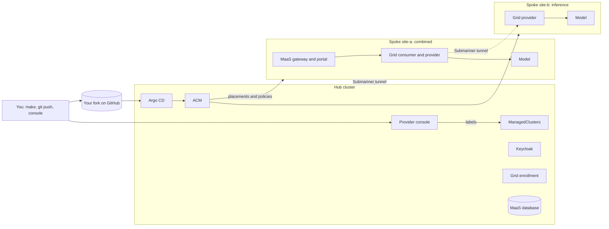

# AI Grid environment guide

This guide shows you how to build an AI Grid environment from this repository: one hub cluster
that manages everything, and one or more spoke clusters that serve models. Follow the pages in
order the first time.

1. [Check the prerequisites](1-prerequisites.md)
2. [Configure your clusters and fork](2-configure.md)
3. [Build the hub](3-build-the-hub.md)
4. [Add a spoke](4-add-a-spoke.md)
5. [Serve a model from another site (inference split)](5-inference-split.md)
6. [Sign in as a tenant](6-tenant-sign-in.md)
7. [Remove a spoke or tear down](7-remove-a-spoke.md)
8. [Run your own clusters from the template](8-run-your-own-clusters.md)

When something fails, see [Troubleshooting](troubleshooting.md). For every `make` target, variable,
and file, see the [Reference](reference.md). The [runbook](../runbook.md) is the engineers' log of
builds, measured timings, and findings; you don't need it to follow this guide.

> **Note:** Each page says which steps have run on a real cluster and which haven't yet. Steps marked
> *not yet run on a cluster* are designed and reviewed but unproven. Steps marked *pending PR N*
> depend on a pull request that isn't merged into `main` yet.

## What you build

An AI Grid environment has two kinds of clusters:

- **The hub** runs Red Hat Advanced Cluster Management (ACM), OpenShift GitOps (Argo CD), Keycloak,
  grid enrollment, the provider console, and the databases. It doesn't run OpenShift AI or serve
  models.
- **Spokes** run OpenShift AI, Models as a Service (MaaS), and the grid. They serve models to tenants.

The hub never installs a spoke directly. You add a cluster to AI Grid in the provider console, which
puts labels on the cluster's `ManagedCluster` object on the hub. ACM placements select clusters by
those labels, and Argo CD and ACM policies deliver the software to every selected cluster.

### Spoke roles

When you add a spoke, you choose its role:

| Role | Runs | Use it when |
|---|---|---|
| `combined` | MaaS (the tenant entry point), the grid consumer and provider, and a model | You want one cluster that tenants call and that serves models. Start here. |
| `inference` | OpenShift AI, the grid provider, and a model; no MaaS | You want a site that serves models to requests that enter through another spoke's MaaS. |
| `ingress` | MaaS and the grid consumer; no model | You want an entry point that forwards every request to inference sites. |

### What each component does

- **ACM** imports clusters, decides which clusters get what (placements), and enforces settings on
  them (policies), such as the image pull secret.
- **Argo CD** reads this repository from your fork and applies it: the hub's own apps under `apps/`,
  and the spoke software under `spokes/`, through ApplicationSets that follow the ACM placements.
- **The grid** routes a tenant's request from the MaaS gateway on one spoke to a model on the same
  or another spoke, over mutual TLS. Each spoke is a *site*; sites enroll with grid enrollment on the
  hub.
- **Submariner** connects the clusters' networks, so spokes reach the hub's database and enrollment,
  and consumers reach providers on other sites.
- **Keycloak** on the hub signs tenants in. Each organization signs in through its own identity
  provider, brokered by the realm `ai-grid`.
- **The provider console** is the web UI where a provider admin adds clusters to AI Grid and
  manages organizations.

## What you edit and what you don't

You change the environment in three ways:

- **Your local files**, which stay out of git: `clusters.local.yaml` (cluster logins) and `.env`
  (your registry login).
- **Commits to your fork**, which Argo CD applies: a spoke's invite and models directory, and the
  certificate digests and addresses that the scripts print for you to commit.
- **The provider console**, which labels clusters: **Add to AI Grid** and **Remove**.

The scripts never commit for you without asking. For the full list of files, see
[Files you edit](reference.md#files-you-edit).
